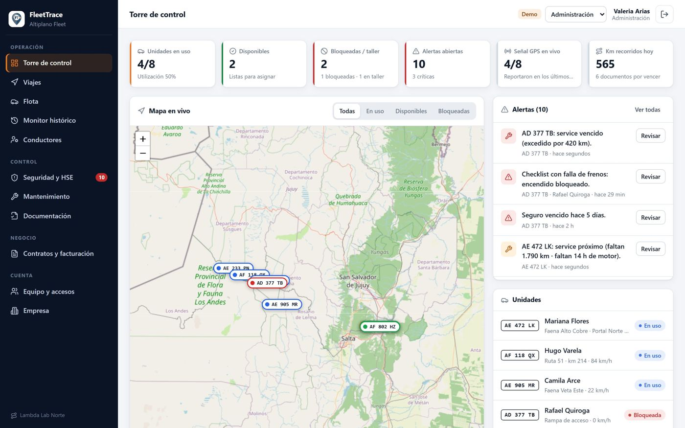
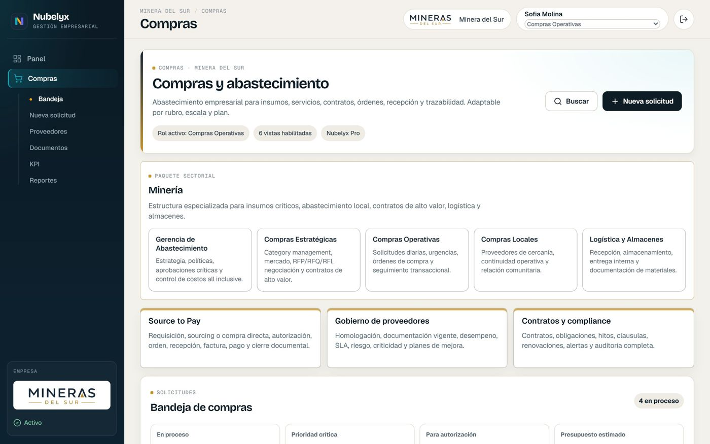
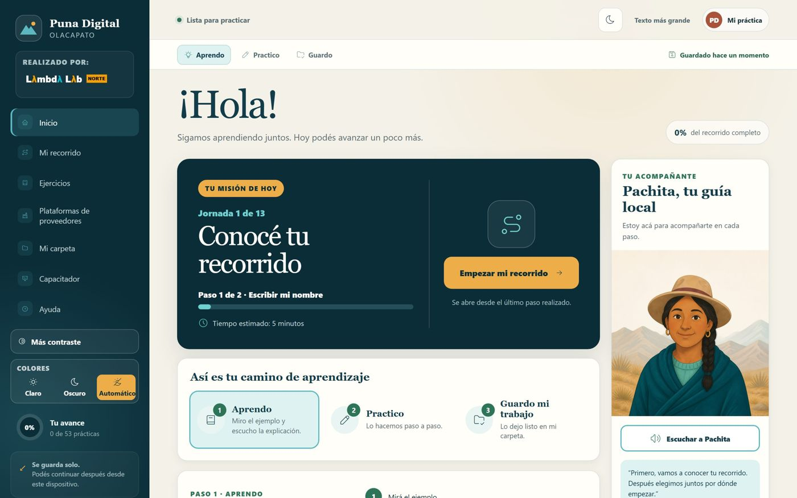
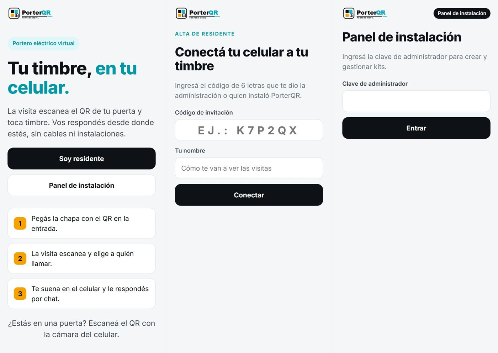
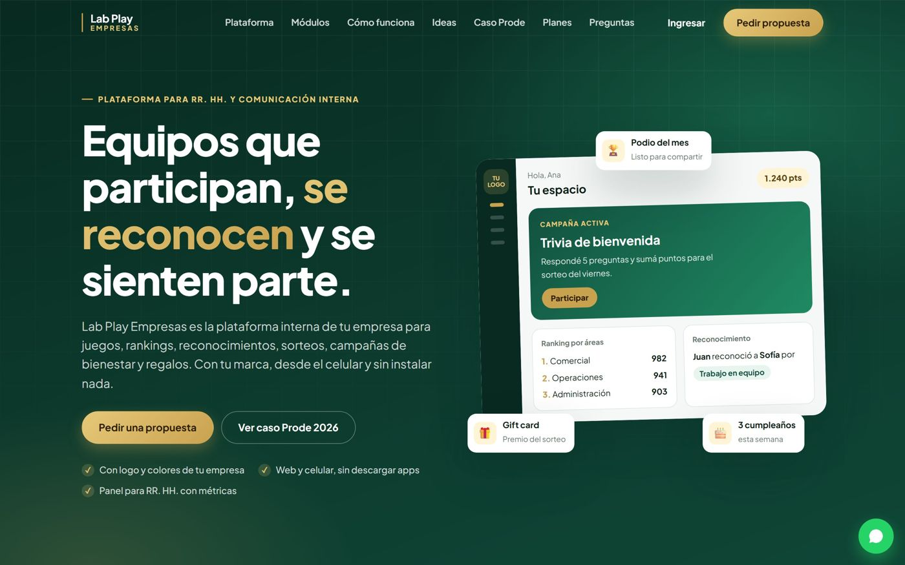
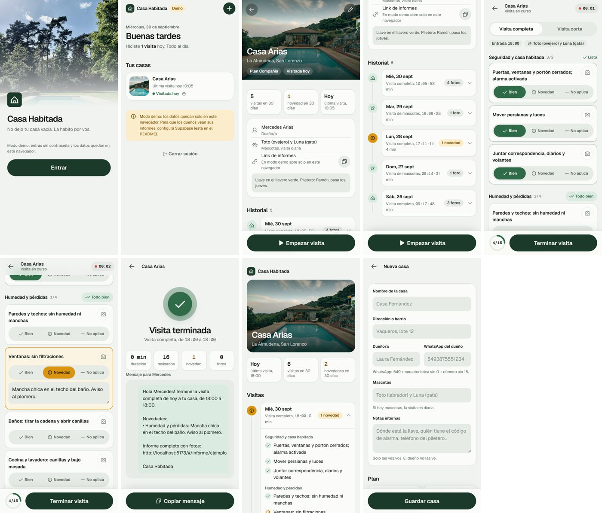
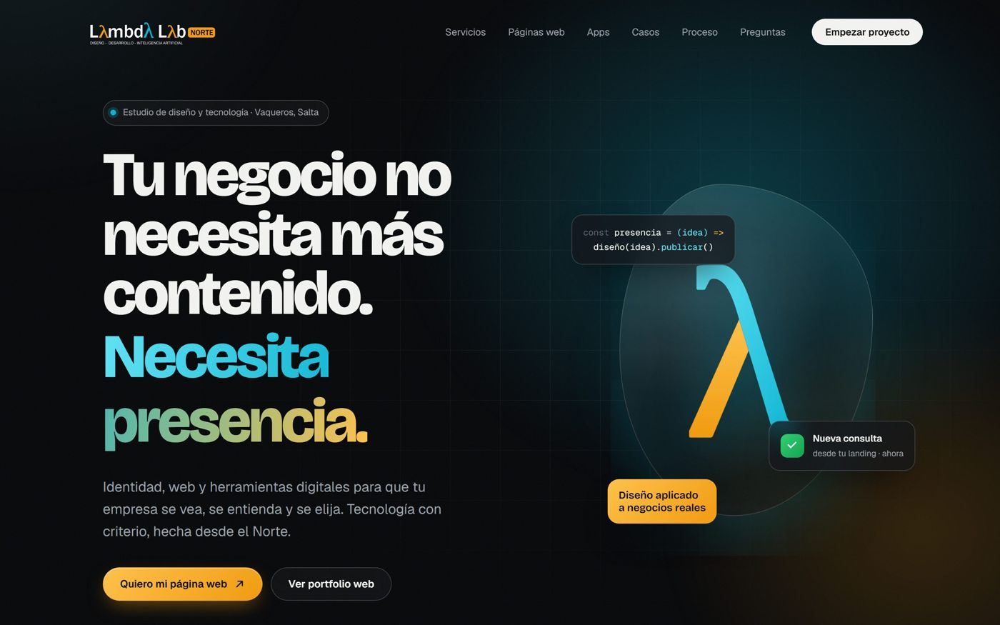

<h1 align="center">Rosario Pierrestegui</h1>

  Diseño y desarrollo de aplicaciones web para empresas · <a href="https://www.lambdalab.com.ar"><strong>Lambda Lab Norte</strong></a> · Salta, Argentina

  
  
  
  
  
  

Construyo productos digitales completos: diseño de interfaz, frontend, backend, seguridad y publicación. Estos son algunos de los proyectos en producción. El código fuente es privado; se puede ver cada producto funcionando en su demo.

---

### FleetTrace · Gestión de flotas para minería
Control de camionetas alquiladas a operaciones mineras: GPS en vivo, viajes con ruta autorizada, SOS y detección de choques, checklists, mantenimiento, app para conductores y prefacturación por contrato.
 React · TypeScript · Firebase · Leaflet · PWA · **[Ver demo](https://fleettrace-lab-norte.web.app)**

### Nubelyx · SaaS de gestión empresarial
Plataforma multiempresa modular: compras, finanzas, logística, RR. HH. y seguridad e higiene, con marca propia por empresa y roles predefinidos.
 React · Firebase · Multi-tenant · **[Ver demo](https://www.lambdalab.com.ar/nubelyx-demo/)**

### Puna Digital · Plataforma educativa
Capacitación digital para la comunidad de Olacapato: simuladores de Word, Excel, PowerPoint, ARCA y plataformas de proveedores mineros. Funciona sin conexión y gestiona cursos, alumnos e informes.
 Next.js · TypeScript · Prisma · Supabase · PWA offline-first

### PorterQR · Portero eléctrico virtual
La visita escanea el QR de la puerta y el residente atiende desde el celular, en tiempo real y con validación por ubicación.
 JavaScript · Firebase Realtime Database · PWA · **[Ver sitio](https://porterqr.lambdalab.com.ar)**

### Lab Play Empresas · Participación y bienestar para RR. HH.
Juegos, rankings, reconocimientos y premios con la marca de cada empresa. Incluye Prode 2026, un prode corporativo usado por empresas reales.
 JavaScript · Firebase · Cloud Functions · **[Ver sitio](https://prode2026-corporativo.com)**

### Casa Habitada · App de informes
Registro de visitas de cuidado de casas con checklist y fotos, e informe privado para cada propietario.
 React · Supabase · Netlify · **[Ver demo](https://casa-habitada-salta.netlify.app/?demo)**

### Lambda Lab Norte · Sitio del estudio
Sitio institucional con portfolio de webs demo adaptables a cada cliente y productos propios.
 HTML · CSS · JavaScript · Firebase Hosting · **[Ver sitio](https://www.lambdalab.com.ar)**

---

  ¿Tenés un proyecto? <a href="https://wa.me/5493815539646"><strong>Escribime por WhatsApp</strong></a> · <a href="https://www.lambdalab.com.ar">lambdalab.com.ar</a>

© Rosario Pierrestegui · Lambda Lab Norte. Las capturas y los productos mostrados son propiedad de sus autores. Todos los derechos reservados.

